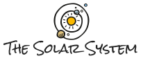

  

  
  
  
  

  <a href="https://rafaelfachinelli.github.io/thesolarsystem/">Live demo</a>

  <a href="#information_source-about">About</a> •
  <a href="#arrow_forward-run">Run</a> •
  <a href="#hammer_and_wrench-technologies">Technologies</a> •
  <a href="#muscle-contributors">Contributors</a> •
  <a href="#boy-author">Author</a> •
  <a href="#balance_scale-license">License</a>

---

## :information_source: About

🌎 An informative site about the planets of the solar system, my first contact with HTML and CSS, made at Mackenzie Presbyterian University in 2016. Simple as it is, the content and the design were a passion of its authors, so it stays as it was, for the memories.

---

## :arrow_forward: Run

No build step. Open `index.html` in a browser, or see the [live demo](https://rafaelfachinelli.github.io/thesolarsystem/).

---

## :hammer_and_wrench: Technologies

|Web|
|:---:|
|[HTML5](https://developer.mozilla.org/en-US/docs/Web/HTML)|
|[CSS3](https://developer.mozilla.org/en-US/docs/Web/CSS)|

---

## :muscle: Contributors

<table>
  <tr>
    <td align="center">
      <a href="https://github.com/rafaelfachinelli">
        
         
        <b>Rafael Fachinelli</b>
      </a>
    </td>
    <td align="center">
      <a href="https://github.com/WallyssonChristian">
        
         
        <b>Wallysson Christian</b>
      </a>
    </td>
  </tr>
</table>

---

## :boy: Author

<a href="https://rafaelfachinelli.com">
  
   
  <b>Rafael Fachinelli</b>
</a>

Tech Lead and software engineer. Get in touch!

---

## :balance_scale: License

This project is under the [MIT license](./LICENSE).
